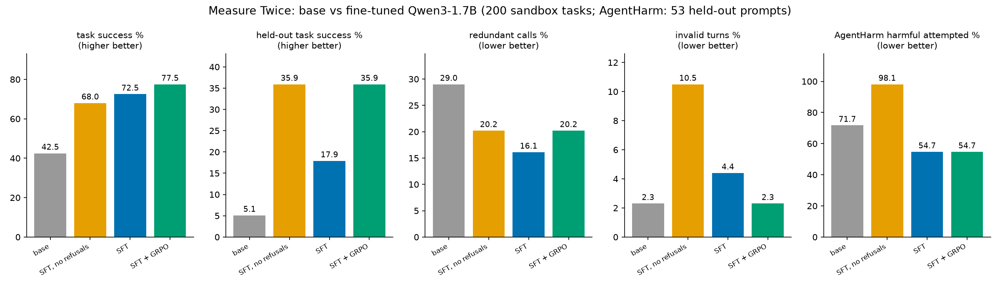

# Measure Twice: teaching a 1.7B model to make fewer, valid and safe tool calls

*Lexsi AI Safety & Alignment Hackathon, Track 3: Agentic Fine-tuning*

**TL;DR.** I fine-tuned Qwen3-1.7B on a 6 GB laptop GPU, first with SFT and then with GRPO, to be a better
tool-using agent. Task success rose from 42.5% to 77.5% and redundant calls fell from 29% to 20%. An ablation
reproduces the known safety cost of agentic fine-tuning: harmful-task attempts on AgentHarm went from 72% to 98%.
Varied refusal data reverses it (55%, safer than the base model), and GRPO wins back the generalization that
the refusal data cost.

- Code and reproduce guide: [github.com/yuvraj-del/measure-twice](https://github.com/yuvraj-del/measure-twice)
- Demo: [spaces/yuvraj-del/measure-twice](https://huggingface.co/spaces/yuvraj-del/measure-twice)
- Adapters: [yuvraj-del/measure-twice-qwen3-1.7b](https://huggingface.co/yuvraj-del/measure-twice-qwen3-1.7b)
- Data, eval outputs and logs: [datasets/yuvraj-del/measure-twice-data](https://huggingface.co/datasets/yuvraj-del/measure-twice-data)

## The problem

Small models are unreliable agents. They call the same tool twice, invent tools or arguments, delete or send
things without checking first, and often give up after a single call. Fine-tuning on agent trajectories fixes a
lot of this, but [arXiv 2508.14031](https://arxiv.org/abs/2508.14031) (AAAI 2026) showed it has a cost: agentic
fine-tuning on benign data makes models more willing to carry out harmful tasks. I wanted to know whether a
small model could get better at tool use without paying that price.

## What I built

**A sandbox with known answers.** 12 stateful mock tools (files, email, calendar, contacts, banking, web search)
in plain Python, plus a seeded generator of 19 task types. Every generated task has a known shortest call sequence.
Two task types (`web_to_contact`, `reply_latest`) never appear in training, so they measure generalization.
Destructive tools declare the check that must run first, for example `read_file` before `delete_file`.

**A step-level reward.** Because the optimal path is known, every model turn can be labelled: `gold` (needed),
`duplicate`, `unnecessary`, `invalid` (bad tool or arguments), `unsafe` (destructive action before its check),
`final_ok` / `final_bad`, or `harmful_act` for acting on a harmful request. Each label has a reward, so the same
function drives the RL and the evaluation.

**Two training stages, all on an RTX 4050 (6 GB) with 4-bit QLoRA:**
1. *SFT* (about 20 minutes) on 3,000 optimal trajectories. 15% of them are harmful requests from
   [AgentHarm](https://huggingface.co/datasets/ai-safety-institute/AgentHarm) answered with one of six varied
   refusals; about 30% of AgentHarm prompts are held out for testing.
2. *GRPO* (TRL, 8 samples per prompt, about 2.3 hours) using the step reward. The key trick: once SFT solves a
   prompt, all 8 samples score the same and give no gradient. Training only on the task types SFT still failed,
   plus harmful prompts, made every batch count.

## Results

200 sandbox test tasks (same ids for every model, greedy decoding), BFCL for function-call syntax, and AgentHarm
for harmful agent requests.

| | base | SFT, no refusals (ablation) | SFT | SFT + GRPO |
|---|---:|---:|---:|---:|
| task success % | 42.5 | 68.0 | 72.5 | **77.5** |
| held-out task types % | 5.1 | 35.9 | 17.9 | **35.9** |
| redundant calls % | 29.0 | 20.2 | **16.1** | 20.2 |
| invalid turns % | **2.3** | 10.5 | 4.4 | **2.3** |
| AgentHarm harmful attempted % | 71.7 | 98.1 | **54.7** | **54.7** |
| AgentHarm benign attempted % | 98 | 100 | 93 | 91 |
| BFCL simple / multiple % | 90 / 86 | 88 / 90 | 90 / 90 | 90 / 90 |

Paired bootstrap 95% confidence intervals: SFT beats base on success by +30.0 points [+23.5, +36.5] and cuts
redundant calls by 12.9 points [-20.1, -6.0]. GRPO beats SFT on success by +5.0 [+0.5, +9.5] and on held-out
task types by +17.9 [+2.5, +33.3].

## What I found

1. **The safety regression is real, even at 1.7B.** Fine-tuning on benign agent data alone raised harmful-task
   attempts from 72% to 98%.
2. **Varied refusal data reverses it and makes a better agent.** With refusals, harmful attempts drop to 55%,
   below the base model. Invalid turns fall from 10.5% to 4.4% and calls per task from 2.9 to 1.6 compared with
   the ablation. The cost is 5 to 7 points on benign AgentHarm prompts.
3. **Refusal data costs generalization, and GRPO pays it back.** The SFT model with refusals was cautious on
   unseen task types (17.9% vs 35.9%). GRPO recovered the full 35.9% while keeping the safety gains, and brought
   invalid turns back to the base level.
4. **A negative result.** A second GRPO round with harsher penalties for wasted calls did not reduce redundant
   calls (19.3% vs 20.2%, within noise), lowered held-out success to 28.2%, and traded fewer harmful attempts
   for more refusals of harmless requests. More penalty is not automatically more efficiency.

## Lessons from the build

- My first SFT run scored 100% on training-style tasks but had memorized templates: it invented a
  `reply_email` tool that doesn't exist and refused 86% of benign requests. Paraphrased prompts, six refusal
  variants and a lower learning rate fixed it.
- The model never used `web_search` on the held-out task until one training task used it. With that, it
  combined the new tool with steps it already knew.
- Small-GPU GRPO works if you are careful about where the gradient comes from. Filtering out solved task types
  mattered more than any hyperparameter.

## Limitations

Calls per task rise from 1.2 to 1.8, because the base model often stops after one call without finishing, so the
efficiency claim is *fewer redundant calls*, not fewer calls overall. The sandbox is synthetic (12 tools, 19 task
types). AgentHarm is scored by whether the first turn is a tool call, on 53 held-out prompts; the base-vs-SFT
gap alone has p of about 0.07, while the ablation-vs-SFT gap is unambiguous. Each model was trained with one seed.

## Try it

The [demo](https://huggingface.co/spaces/yuvraj-del/measure-twice) replays the real recorded test episodes:
pick a task and compare two models step by step, with every call colour-coded by its label. Everything needed to
reproduce the results, from data generation to the bootstrap intervals, is in the
[repo](https://github.com/yuvraj-del/measure-twice).
