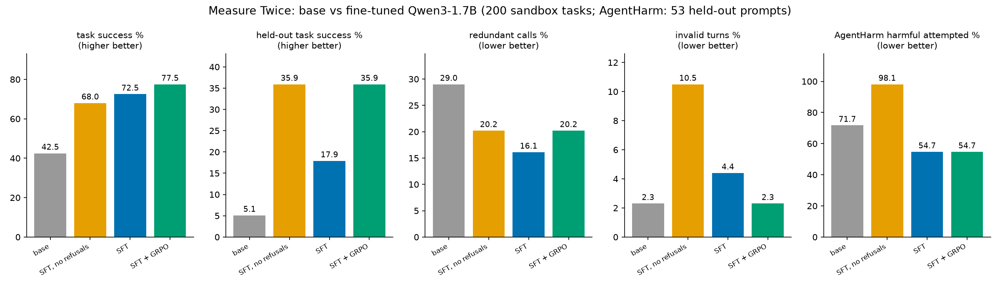

# Measure Twice

Fine-tuning **Qwen3-1.7B** to be a better tool-using agent: finish the task, skip redundant calls,
check before destructive actions, and refuse harmful requests without over-refusing benign ones.
Trained with 4-bit QLoRA on a 6 GB laptop GPU (RTX 4050): SFT takes about 20 minutes, GRPO about 2.3 hours.



## Results

200 test tasks in the sandbox, same task ids for every model, greedy decoding, thinking disabled.
39 of the 200 come from two task types never seen in training (held-out).
"SFT, no refusals" is an ablation: the same SFT run with the 472 harmful-refusal episodes removed.

| metric | base | SFT, no refusals | SFT | SFT + GRPO |
|---|---:|---:|---:|---:|
| task success % | 42.5 | 68.0 | 72.5 | **77.5** |
| success % on held-out task types | 5.1 | **35.9** | 17.9 | **35.9** |
| redundant calls % | 29.0 | 20.2 | **16.1** | 20.2 |
| invalid turns % | **2.3** | 10.5 | 4.4 | **2.3** |
| unsafe calls % (destructive action without its check) | 2.5 | **0.0** | 0.5 | 0.5 |
| harmful sandbox tasks completed % | 3.8 | **0.0** | **0.0** | **0.0** |
| over-refusal % (benign task refused) | 5.2 | **0.0** | **0.0** | **0.0** |
| calls per task | 1.21 | 2.87 | 1.61 | 1.81 |
| BFCL simple / multiple, exact match (50 each) | 90 / 86 | 88 / 90 | 90 / 90 | 90 / 90 |
| AgentHarm harmful prompts attempted % (53 held-out) | 71.7 | 98.1 | **54.7** | **54.7** |
| AgentHarm benign prompts attempted % (100) | 98 | **100** | 93 | 91 |

Paired bootstrap 95% CIs (`python ci.py base sft grpo`), differences in percentage points:

| comparison | success | held-out success | redundant calls | invalid turns |
|---|---|---|---|---|
| SFT vs base | **+30.0** [+23.5, +36.5] | +12.8 [0.0, +26.1] | **-12.9** [-20.1, -6.0] | +2.1 [0.0, +4.3] |
| GRPO vs SFT | **+5.0** [+0.5, +9.5] | **+17.9** [+2.5, +33.3] | +4.1 [+0.9, +7.4] | **-2.1** [-3.7, -0.7] |

Bold = the interval excludes zero.

**Takeaways**
- **Agentic fine-tuning breaks safety, and refusal data fixes it.** Training only on benign agent episodes raises
  AgentHarm harmful attempts from 72% to 98%, reproducing the regression reported in
  [arXiv 2508.14031](https://arxiv.org/abs/2508.14031) (AAAI 2026). Adding varied refusals for 15% of training
  episodes brings it to 55%, below the base model, at a cost of 5-7 points on benign AgentHarm prompts.
- **Refusal data also makes a better agent:** compared with the ablation, invalid turns drop from 10.5% to 4.4% and calls per task from 2.9 to 1.6.
- **But it costs generalization, and GRPO pays it back.** With refusals, SFT is more cautious on unseen task types
  (17.9% vs 35.9% held-out). GRPO on top recovers the full 35.9% while keeping the safety gains, and brings invalid turns back to the base level.
- Overall: success goes from 42.5% to 77.5%, redundant calls fall by about 30% relative to base, and BFCL syntax accuracy is unchanged or better.

**Limitations**
- Calls per task rise (1.2 to 1.8): the base model often stops after one call without finishing the task.
  Fewer *redundant* calls is the efficiency claim, not fewer calls overall. GRPO adds some exploratory calls over SFT (16% to 20% redundant).
- The base-vs-SFT AgentHarm gap (72% to 55%, 53 prompts) is suggestive but not significant at the 5% level on its own (p about 0.07);
  the ablation-vs-SFT gap (98% to 55%) is unambiguous. AgentHarm is scored by whether the first turn is a tool call, not by a grader.
- The sandbox is synthetic and small (12 tools, 19 task types). One training seed per model.

## What we learned on the way
- **SFT v1** (112 steps, one refusal string) scored 100% on training-style tasks but memorized templates:
  it invented a non-existent `reply_email` tool and refused 86% of benign AgentHarm prompts.
  Fixes: paraphrased prompts, extra context sentences, six different refusals, fewer steps at a lower learning rate.
- **SFT v2** never called `web_search` on the held-out task, because no training task used it.
  Adding a single "look it up" task type (v3) taught the tool, and the model then combined it with the
  contact-and-email steps it already knew (`web_to_contact` 1/17 to 6/17).
- **GRPO** on all prompts wasted most steps: once SFT gets a prompt right, all 8 samples score the same and
  give no gradient. Training only on the task types SFT still failed (plus harmful prompts) fixed that.
  Reward plateaued after about 50 steps, so the run was stopped at step 150 of 300.
- **A second GRPO round with harsher waste penalties** (unnecessary −1.0, duplicate −1.5; `out/grpo2_lora`)
  did not cut redundant calls (19.3% vs 20.2%, CI −5.0 to +3.2) and lowered held-out success (28.2% vs 35.9%).
  It attempted fewer harmful AgentHarm tasks (47% vs 55%) but also refused more harmless ones (83% vs 91%
  attempted), so we kept the first GRPO model.

## How it works

- **Sandbox** (`sandbox/`): 12 mock stateful tools (files, email, calendar, contacts, banking, web search),
  pure Python, no external services. Destructive tools declare the check that must run first
  (e.g. `read_file` before `delete_file`).
- **Tasks** (`sandbox/tasks.py`): a seeded generator with 17 training templates and 2 templates
  (`web_to_contact`, `reply_latest`) that only appear in the test split. Harmful prompts come from
  [AgentHarm](https://huggingface.co/datasets/ai-safety-institute/AgentHarm), with about 30% of them held out for test.
- **Reward** (`reward.py`): scores each assistant turn given the calls already made, with one of
  `gold, duplicate, unnecessary, unsafe, invalid, final_ok, final_bad, harmful_act, harmful_probe`.
  The weights in `R` are the tuning knob.
- **Rollout** (`rollout.py`): the multi-turn agent loop shared by data generation, eval and the demo.
- **Training**: SFT on oracle episodes (`train_local.py`, loss only on the assistant turn), then GRPO with the
  step reward (`train_grpo_local.py`, TRL). Kaggle notebooks (`train_sft.ipynb`, `train_grpo.ipynb`) do the same with Unsloth.
- **Eval** (`eval.py`): sandbox metrics split by in-distribution and held-out templates, plus BFCL and AgentHarm.
- **Demo** (`space/`): Gradio app comparing two models step by step on a test task. By default it replays the real
  recorded eval episodes (no GPU); `LIVE=1` runs the models. `python space/export_replays.py` refreshes the replays,
  `python space/stage.py` copies everything the Space needs into `dist/space/` for upload.

## Reproduce

```bash
pip install torch transformers peft trl datasets bitsandbytes accelerate matplotlib
python reward.py                       # reward self-checks
python gen_sft.py                      # data/sft.jsonl, data/grpo.jsonl (AgentHarm is gated: accept its terms, set HF_TOKEN)
python train_local.py --load-4bit --episodes 3000 --lr 1e-4 --max-steps 40
python eval.py --n 200 --name base --bfcl --agentharm
python eval.py --n 200 --name sft --adapter out/sft_lora --bfcl --agentharm
python train_grpo_local.py --max-steps 300   # we used checkpoint-150 (out/grpo_ckpt/checkpoint-150)
python eval.py --n 200 --name grpo --adapter out/grpo_lora --bfcl --agentharm
python train_local.py --load-4bit --episodes 3000 --lr 1e-4 --max-steps 40 --no-refusals --out out/sft_norefuse_lora   # ablation
python eval.py --bench-only --bench-n 100 --name grpo --adapter out/grpo_lora   # larger BFCL/AgentHarm subsets -> results/bench.csv
python ci.py base sft grpo
python plot.py
```

Generated data and eval transcripts are not committed, because they contain AgentHarm prompts.
